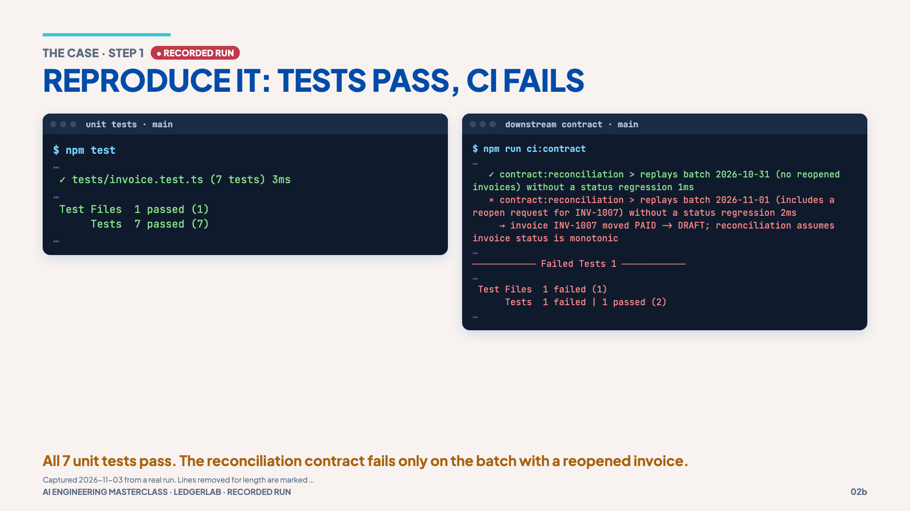

# 01 · The blocked release

> **The idea:** "Fix the failing tests" sounds reasonable, but here nothing fails
> locally, so it points the AI at the wrong target.

## The concept

Before giving an AI agent the power to change code, you need to know *what is
actually wrong*. In LedgerLab the unit tests are green, but a **downstream
contract check** (the reconciliation service's rule that invoice status only
ever moves forward) fails, and only some of the time. The failure lives in a
place the obvious prompt never points at.

## Reproduce it

```bash
git switch main
npm test
npm run ci:contract
```

You should see:

```text
$ npm test
 ✓ tests/invoice.test.ts (7 tests)
      Tests  7 passed (7)

$ npm run ci:contract
   ✓ contract:reconciliation > replays batch 2026-10-31 (no reopened invoices) without a status regression
   × contract:reconciliation > replays batch 2026-11-01 (includes a reopen request for INV-1007) without a status regression
     → invoice INV-1007 moved PAID -> DRAFT; reconciliation assumes invoice status is monotonic
      Tests  1 failed | 1 passed (2)
```

Why it fails only sometimes: the contract replays a **batch** of status-change
requests through the real `changeStatus` code ([`contract/reconciliation.ts`](../contract/reconciliation.ts)).
Only the 2026-11-01 batch ([`contract/batches/`](../contract/batches/)) contains a
request to reopen a paid invoice. Batches without one pass, so CI is intermittently red.

The shorter CI log the team saw is [`logs/ci-failure.log`](../logs/ci-failure.log).

## The vote from the session

The room was asked which prompt they would send first:

| | Prompt | What could go wrong |
|---|---|---|
| **A** | `Fix the failing tests.` | Nothing fails locally, so it aims at the wrong target. Claude may weaken or skip a test, edit the CI job or the generated fixtures, and report "fixed" with no evidence. Nothing limits what it may edit. |
| **B** | `Why is v0.8.0 blocked? Investigate only, don't edit.` | The right instinct, but a prompt is a request, not a boundary: Claude can still edit unless a mode or permission enforces it. It may stop at a plausible guess unless you ask for evidence. |
| **C** | `Read the CI log and tell me what failed.` | Finds the symptom (INV-1007) fast, but a symptom is not the cause. A long log floods the context (chapter 03), and Claude may call it flaky or patch the check instead of the code. |

**Best start:** B, using C's log as evidence, in a mode that actually blocks
edits. The rest of the walkthrough builds exactly that.

## What it shows

- Green unit tests are not the same as a working system.
- An intermittent failure is a data question ("which batches fail?"), not
  necessarily flaky infrastructure.
- The quality of the result depends on how the task is framed and bounded,
  not on how clever the model is.

## Misconception

> "If the tests pass, the code is fine." Tests only prove what they check. None
> of the 7 tests tries moving an invoice out of PAID.

## Recorded run



**Next →** [02 · Model vs harness](02-model-vs-harness.md)
