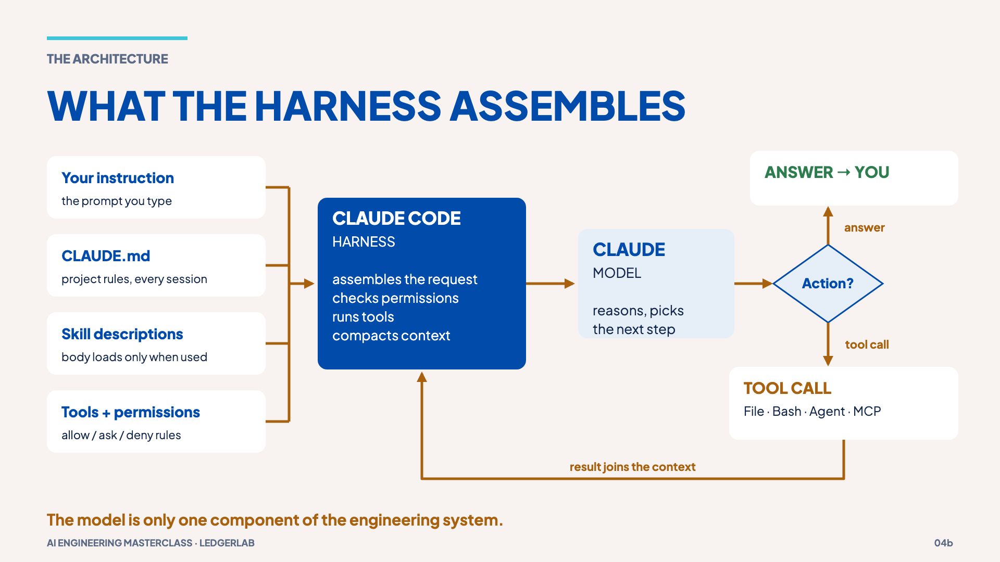

# 02 · Model vs harness

> **The idea:** when you use Claude Code you are not just talking to a model; you
> are using a **harness** that assembles the request, runs tools and manages context.

## The concept

A language model on its own only turns input text into output text. It does not
remember previous calls: each API call sees only what is sent with it.

**Claude Code is a harness** around the model. On every turn it:

1. Assembles the request: your instruction, `CLAUDE.md`, the list of available
   skills (descriptions only), tool definitions, and the conversation so far.
2. Sends it to the model. The model either **answers**, or asks for a **tool call**
   (read a file, run a command, call an MCP tool, start a subagent).
3. Checks permissions, runs the tool, and adds the **tool result** to the conversation.
4. Repeats until the model answers.

Claude Code's docs describe this agentic loop as *gather context → take action →
verify results*. If you have built on the Messages API, it is the familiar loop:
the model returns `stop_reason: "tool_use"`, your code runs the tool and sends back
a `tool_result`. The harness writes that loop for you, and adds permissions,
context management and compaction.



## Reproduce it

Start Claude Code in the repo and give it a small, read-only task:

```bash
claude
```

```text
Read src/transitions.ts and tell me which transitions are allowed out of each status.
Do not edit anything.
```

Watch the loop: Claude asks for a file read (a tool call), the harness runs it,
the file contents come back (a tool result), and Claude answers. Then type:

```text
/context
```

You will see what is filling the context window: system instructions, `CLAUDE.md`,
tool definitions, skill descriptions, and the file you just read.

## What it shows

Most of what makes Claude Code useful (or risky) is decided by the harness: which
instructions are loaded, which tools exist, what needs permission, and what gets
kept or dropped. That is what the rest of this walkthrough engineers.

## Misconception

> "The model remembers our chat." It sees only what the harness sends on each
> call. Memory across turns is the app resending the history, which has a cost
> (chapter 03).

**Next →** [03 · Context is a budget](03-context-is-a-budget.md)
