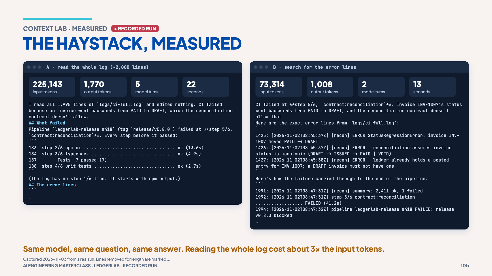

# 03 · Context is a budget

> **The idea:** every tool result joins the conversation and is paid for again on
> every later turn. A 2,000-line log pasted into context? You imported the haystack.

## The concept

The context window is a finite budget shared by instructions, history, file
contents and tool results. Tokens are the meter: tool definitions, `tool_use`
blocks and `tool_result` blocks all count as input tokens. A big tool result
does not just cost once; it stays in the conversation and is sent again with
every later turn, crowding out what matters.

The fix is not "more context". It is **narrower observations**: search for the
failing lines instead of reading the whole log.

## Reproduce it

[`logs/ci-full.log`](../logs/ci-full.log) is a 1,994-line synthetic CI log
(generated by [`scripts/make-full-log.mjs`](../scripts/make-full-log.mjs)) with the
real error buried at line 1,425. The script below asks Claude Code the same
question twice, read-only:

- **A** may only *read* the file (search tools disabled).
- **B** may only *search* it (the Read tool disabled).

```bash
MODEL=claude-opus-5-5 npm run measure:haystack
```

Pin both runs to the same `MODEL`, or the comparison is not fair. Each run uses
real tokens on your account.

## What the session measured (one run each, 2026-11-03)

| Run | Input tokens | Model turns | Seconds | Answer |
|---|---|---|---|---|
| A · read the whole log | **225,143** | 5 | 22 | INV-1007 PAID → DRAFT, `StatusRegressionError` |
| B · search for error lines | **73,314** | 2 | 13 | the same |

Same model, same question, same answer, **about 3× the input tokens** to read
everything. Your numbers will differ, but the gap should not disappear.



## What it shows

- Ask tools for the smallest observation that answers the question.
- Inside Claude Code, `/context` shows what is filling the window.
- This is also why subagents help (chapter 07): they can read the haystack in
  *their* context and hand back a short summary.

## Misconception

> "More context is always better." More context includes more noise, and it is
> paid for on every turn.

**Next →** [04 · Compaction and durable state](04-compaction-and-durable-state.md)
