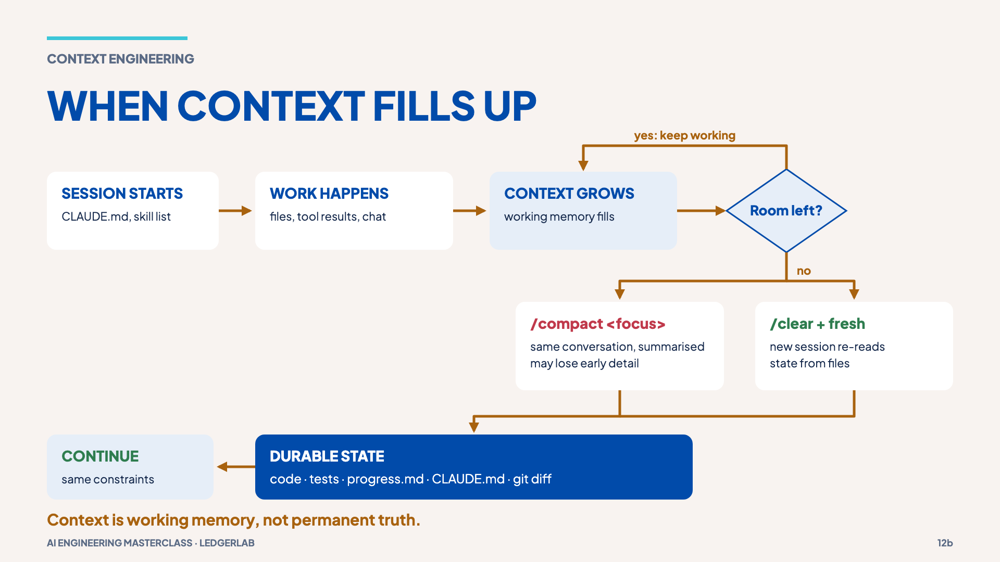
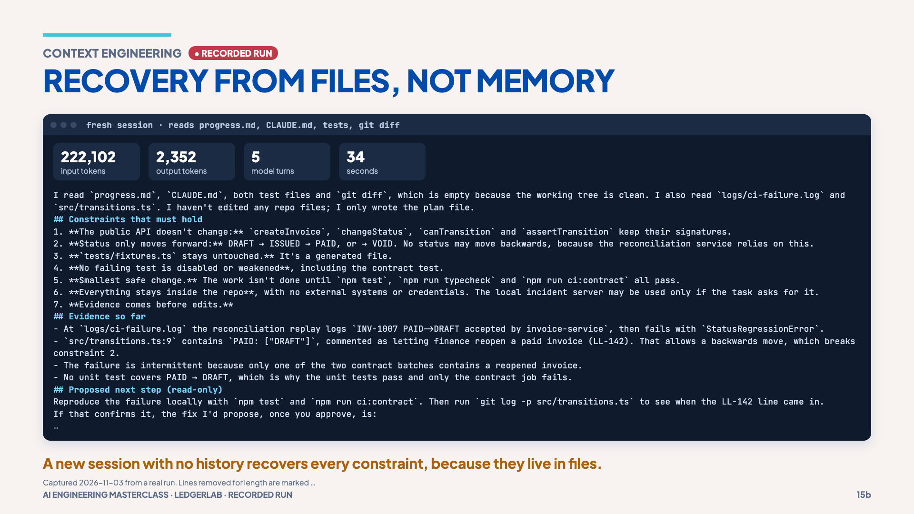

# 04 · Compaction and durable state

> **The idea:** conversation is working memory; the repository is durable memory.
> Keep the rules that must survive in files, not in the chat.

## The concept

When the context fills up, Claude Code **compacts**: it replaces older
conversation with a summary. The docs note the summary keeps your requests and
key code, but detailed instructions from early in the conversation may be lost.
You can steer it (`/compact <focus>`), or start fresh (`/clear`) and let a new
session rediscover the state from files.



LedgerLab keeps its rules in two durable places:

- [`CLAUDE.md`](../CLAUDE.md): project rules loaded at the start of every session.
- [`progress.md`](../progress.md): task state and **the constraints that must
  survive**: public API frozen, status only moves forward, generated fixtures untouched.

## Reproduce it

**1. The failure (illustration).** You cannot reliably force a compaction on
demand, so the session used a hand-written example of a lossy summary:
[`fallbacks/disappearing-constraint/lossy-summary.md`](../fallbacks/disappearing-constraint/lossy-summary.md).
Read it and spot what it lost. Its "next step" would change a public function
signature, keep PAID → DRAFT and edit generated fixtures, breaking all three constraints.

**2. Recovery from files (real).** Start a brand-new session with no history:

```bash
npm run measure:recovery
```

or interactively (`claude`, then paste):

```text
Before doing anything, read progress.md, CLAUDE.md, the tests, and the output of
git diff. List the constraints that must hold for this task, then propose the
next step. Do not edit files.
```

**What the session's run recovered** (2026-11-03): all seven constraints. Public API
unchanged; status only moves forward; `tests/fixtures.ts` untouched; no test
weakened; smallest safe change, with `npm test`, `typecheck` and `ci:contract`
all passing; stay inside the repo; evidence before edits. It also identified the
cause and why the failure is intermittent.



**3. Optional, interactive.** In a long session, try `/compact Keep every
constraint from progress.md verbatim`, then ask Claude to list the constraints.
Compare that with step 2.

## What it shows

Constraints survived because they live in files that any new session reads.
Compaction is a continuation strategy, not a guarantee.

## Misconception

> "Compaction preserves everything that matters." A summary is smaller; it is
> not a perfect copy. Persist what must survive.

**Next →** [05 · CLAUDE.md, skill or agent?](05-claude-md-skill-or-agent.md)
