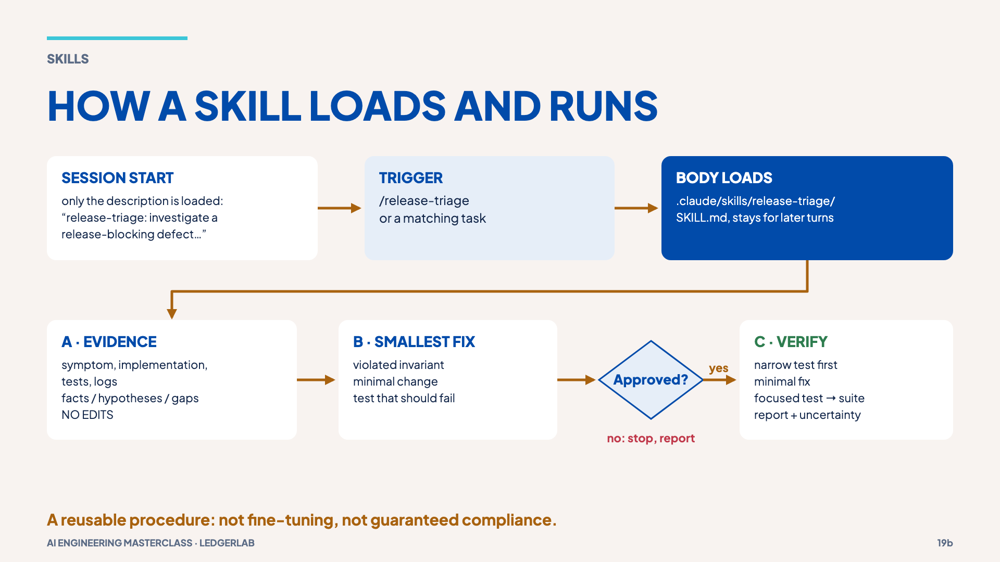
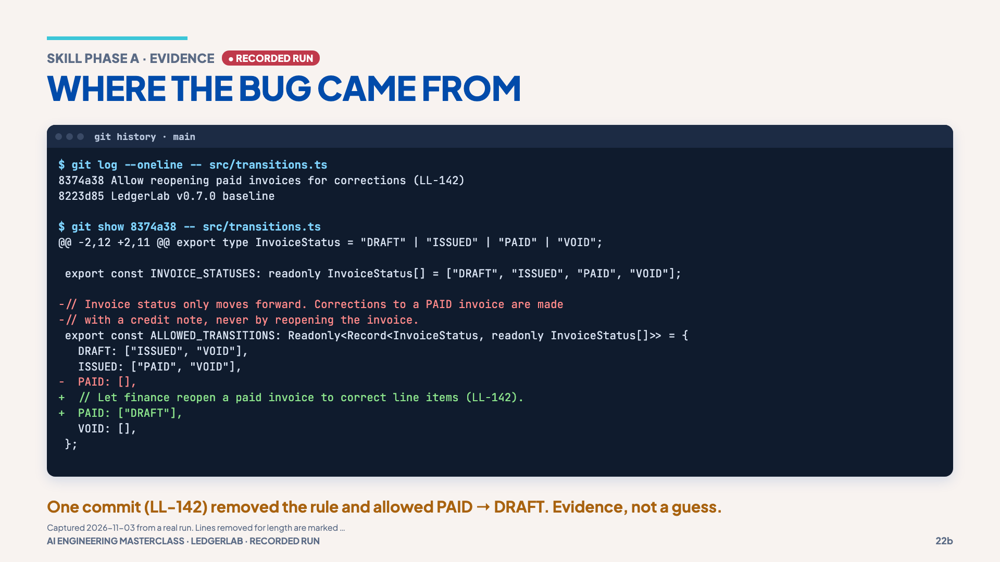
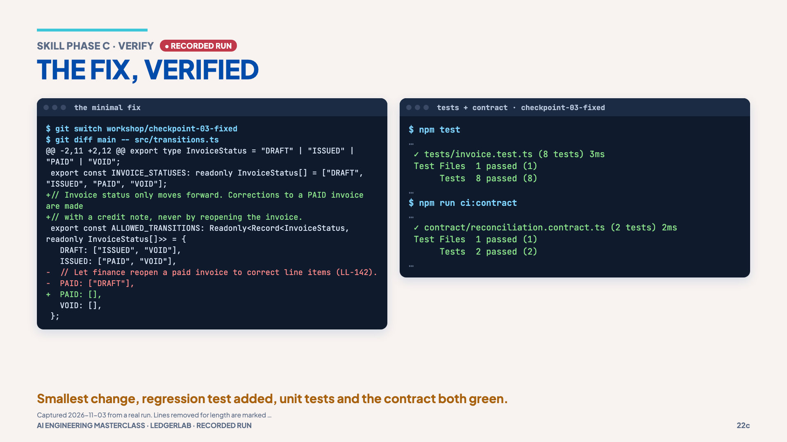

# 06 · A skill-driven triage

> **The idea:** if you repeat a process, package it. Evidence before edits, then
> prove the fix with a test that goes red, then green.

## The concept

The [`release-triage`](../.claude/skills/release-triage/SKILL.md) skill encodes the
team's procedure in three phases:

- **A · Evidence**: symptom, implementation, tests, logs; list facts,
  hypotheses and gaps. **No edits.**
- **B · Smallest fix**: name the violated rule, the minimal change, and the
  test that should fail first. **Ask for approval.**
- **C · Verify**: add the narrow test, make the minimal fix, run the focused
  test then the suite, and report what changed and what is still uncertain.



A skill is an instruction package, not fine-tuning and not a guarantee. So you
judge the run by **behaviour**, using [`expected/checklist.md`](../expected/checklist.md),
not by its wording.

## Reproduce it

**1. Without the skill** (fresh session, `claude`):

```text
Triage the invoice defect: a PAID invoice can go back to DRAFT and release v0.8.0 is blocked.
```

Note what it does: does it read the tests first, separate facts from guesses, or
try to edit?

**2. With the skill** (`/clear` first):

```text
/release-triage
Investigate why a PAID invoice can become DRAFT.
Do not edit files.
Identify the violated rule, relevant test and smallest safe fix.
```

Check the result against [`expected/checklist.md`](../expected/checklist.md). A
reference answer is on `workshop/checkpoint-01-investigated` in `reports/triage.md`.

**3. Phase A evidence: where the bug came from.**

```bash
git log --oneline -- src/transitions.ts
git show 8374a38 -- src/transitions.ts
```

```text
8374a38 Allow reopening paid invoices for corrections (LL-142)
8223d85 LedgerLab v0.7.0 baseline

-// Invoice status only moves forward. Corrections to a PAID invoice are made
-// with a credit note, never by reopening the invoice.
-  PAID: [],
+  // Let finance reopen a paid invoice to correct line items (LL-142).
+  PAID: ["DRAFT"],
```

One commit removed the rule. That is a fact with a source, not a guess.



**4. Phase C: red, then green.**

```bash
git switch workshop/checkpoint-02-tested   # regression test added
npm run where                              # STEP 3 · Red: 7/8 pass, the new test fails
git switch workshop/checkpoint-03-fixed    # smallest fix: PAID: []
npm run where                              # STEP 4 · Green: 8/8 pass, contract 2/2
```

The test failing *before* the fix proves it catches the bug. Both checks passing
*after* proves the fix, including the downstream contract from chapter 01.



## What it shows

The same model, given a written procedure, produces a result you can check step
by step. And "fixed" means two green runs you executed yourself.

## Misconception

> "If Claude says tests pass, the task is done." The test output, the diff and
> the contract run are the evidence.

**Next →** [07 · Delegation](07-delegation.md)
