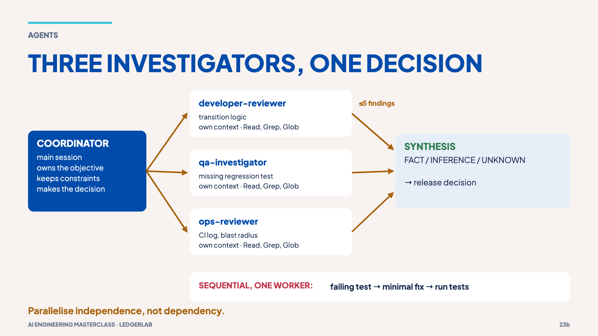
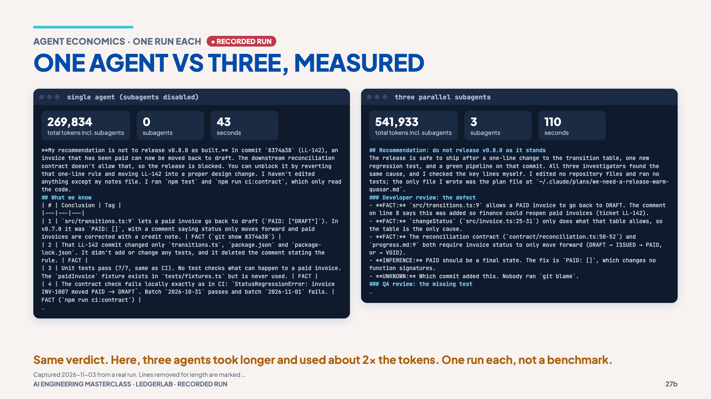

# 08 · Parallelism and its cost

> **The idea:** parallelise independence, not dependency. Parallel is not free
> speed: measure it.

## The concept

Three investigations here need none of each other's results, so they *can* run
in parallel: implementation (developer-reviewer), tests (qa-investigator) and the
CI log (ops-reviewer). All three are read-only. The fix itself is **sequential**:
failing test → minimal fix → run tests, done by one worker.



Parallelism can cut wall-clock time when tasks truly overlap. It can also *raise*
total tokens: each subagent re-reads files, and coordination and synthesis cost extra.

## Reproduce it

**Interactively** (`claude`), the three-agent investigation:

```text
We need a release decision for the invoice-status defect.

Run these independent investigations in parallel where appropriate:
- developer-reviewer: inspect the state-transition implementation and identify the likely defect.
- qa-investigator: inspect current tests and identify the smallest missing regression test.
- ops-reviewer: inspect logs/ci-failure.log and identify the operational symptom and blast radius.

Do not edit any files.
After all three return, synthesise a release recommendation.
Explicitly mark each conclusion as: FACT / INFERENCE / UNKNOWN.
```

**Measured**, one agent vs three:

```bash
MODEL=claude-opus-5-5 npm run measure:agents
```

## What the session measured (one run each, 2026-11-03)

| Run | All tokens incl. subagents | Subagents | Seconds | Verdict |
|---|---|---|---|---|
| Single agent (subagents disabled) | **269,834** | 0 | **43** | Don't release; `PAID: []` + regression test |
| Three parallel subagents | **541,933** | 3 | **110** | the same |

In this run, parallel was **slower and about 2× the tokens**, for the same verdict.
That is one run each, not a benchmark, but it is the lesson of this chapter: use
parallelism when isolation or genuinely overlapping work pays for it, not by default.



## Misconception

> "More agents means faster work." Fourteen agents to rename a variable is not an
> optimisation. Never let two agents write the same files.

**Next →** [09 · Verification](09-verification.md)
