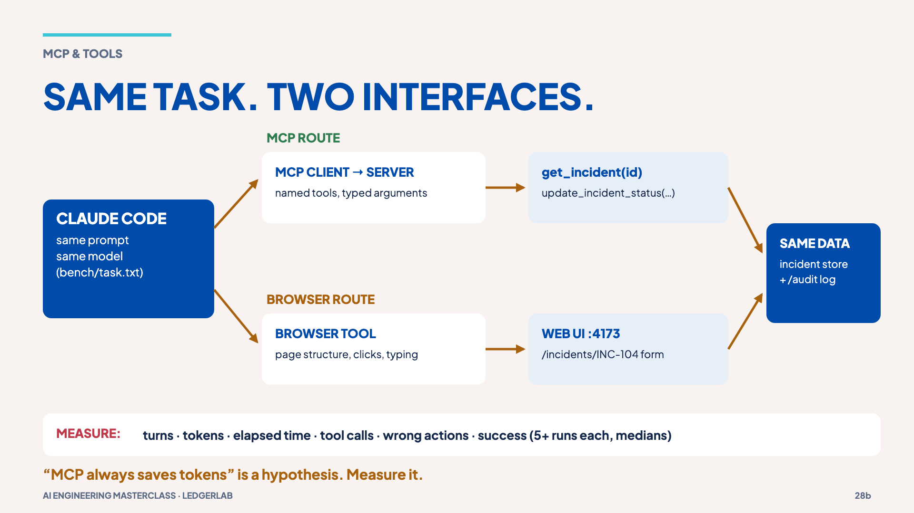

# 10 · MCP vs browser

> **The idea:** the repository is not the whole world. MCP gives Claude named,
> typed tools; a browser gives it a human UI. Same task, different interface:
> measure, don't assume. And a tool result is a claim, not proof.

## The concept

**MCP** (Model Context Protocol) lets the harness connect to a server that
exposes **named tools with typed arguments**. MCP is not a model API; a server
can wrap any existing API, database or service. **Browser automation** instead
reads and clicks a web page built for humans.

This repo has one fictional incident system with **both** interfaces, sharing
the same data and an audit log:

- MCP server: [`mcp/incident-server/server.mjs`](../mcp/incident-server/server.mjs),
  registered as `incidents` in [`.mcp.json`](../.mcp.json). Tools: `get_incident(id)` and
  `update_incident_status(id, status, resolution_note)`.
- Web UI: [`mcp/incident-server/web.mjs`](../mcp/incident-server/web.mjs) on `localhost:4173`.
  `/audit` shows every write from either route.



## Reproduce it

```bash
git switch workshop/checkpoint-03-fixed   # the fix exists here (see the twist below)
npm run incidents:reset
npm run incidents:web                    # leave running
```

In Claude Code, check `/mcp` (approve the project server the first time), and
switch to **Manual** mode with `Shift+Tab` so the write asks you first. The task
is the same for both routes ([`bench/task.txt`](../bench/task.txt)):

```text
Find incident INC-104.
Return its service, severity, owner and current status.
If and only if the resolution note contains evidence that
the regression test passed, change its status to Resolved.
Report every action you took.
```

Add `Use only the incidents MCP tools.` (MCP route) or `Use only the web UI at
http://localhost:4173/incidents/INC-104. Do not use MCP tools.` (browser route,
with a browser tool connected). Reset between runs. Check `http://localhost:4173/audit`:
exactly **one** write, INC-104 Investigating → Resolved. A control: INC-105's note
says "not yet tested", so it must **not** change.

Measure the MCP route headless with `bench/run-mcp.sh mcp-01`. See
[`bench/README.md`](../bench/README.md) for what to record. No results are
published here: a single run proves very little.

## The twist: a tool result is a claim

INC-104's note says the fix and regression test passed. On `main` the fix is
not there. In a rehearsal run on 2026-11-03, Claude **read the note, checked
`src/transitions.ts` and the tests, found the claim unsupported, and refused to
resolve the incident.**
Try the MCP route on `main` and see whether yours does the same.

## Misconception

> "MCP always saves tokens." It is a hypothesis: tool schemas and outputs also
> cost context. Measure your own task.

**Next →** [11 · Permissions and trust](11-permissions-and-trust.md)
