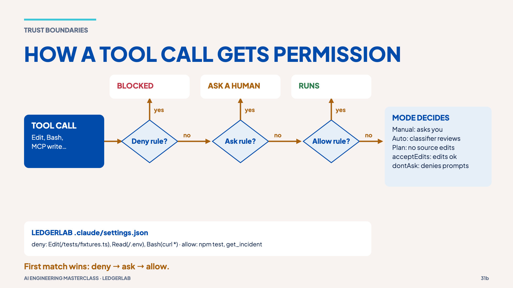

# 11 · Permissions and trust

> **The idea:** once Claude can act, the question changes from "what can it say?"
> to "what can it do?". A rule in `CLAUDE.md` is a request; a permission rule is enforced.

## The concept

Claude Code checks every tool call against permission rules in the order
**deny → ask → allow**, and the first match wins. If no rule matches, the
**permission mode** decides: Manual asks you, Auto has a classifier review it,
Plan explores without editing source, acceptEdits allows file edits, and dontAsk
denies anything that would prompt.



LedgerLab's rules are in [`.claude/settings.json`](../.claude/settings.json):

- **deny**: editing `tests/fixtures.ts`, reading `.env`, `curl` and `wget`.
- **allow**: `npm test`, typecheck, `git log/diff/show`, and the read-only `get_incident`.
- **not allowed, so Manual mode asks**: `update_incident_status`, which writes to another system.

## Reproduce it: asked vs enforced

`CLAUDE.md` *asks* Claude never to edit generated fixtures. The settings file
*enforces* it. In Claude Code:

```text
Add a new PAID invoice for CLIENT-D to tests/fixtures.ts.
```

The edit is blocked by `Edit(/tests/fixtures.ts)`. Then look at the live rules:

```text
/permissions
```

## Try it: approve, reject or ask?

| Request | Verdict | Why |
|---|---|---|
| `Bash(npm test *)` | Approve | Narrow, and needed for verification |
| Edit `tests/fixtures.ts` | Reject | Generated file; denied |
| `curl` to an external host | Reject | The sandbox stays local |
| Write to the incident system | Ask | It changes another system: keep a human gate |
| `--dangerously-skip-permissions` | Reject | Use allow-lists and a permission mode instead |

## What it shows

- Least privilege: allow exactly what the task needs.
- Approval gates for anything that changes other systems.
- Tool output and web pages are **untrusted input**: instructions inside them
  are data, not commands (try the injection exercise in
  [`prompts/extensions/mcp-security.md`](../prompts/extensions/mcp-security.md)).
- `/rewind` undoes file edits, not remote side effects.

## Misconception

> "A connected MCP server is trusted." Servers, their tool definitions and their
> results are all security surfaces.

**Next →** [12 · Recap](12-recap.md)
